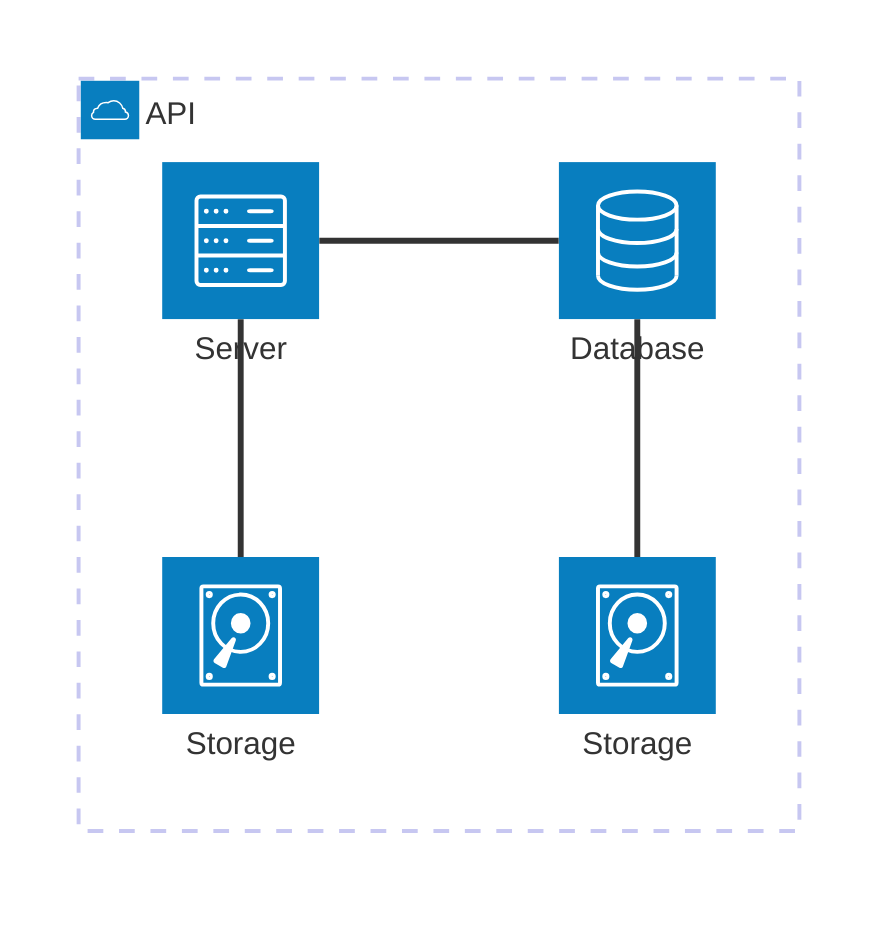

## Syntax

- `group id(icon)[Label]` and `service id(icon)[Label]` declare boxes; `in group` nests one.
- `a:L -- R:b` joins two services at a side each: `L`, `R`, `T` or `B`. `-->` and `<--` put an arrow at an end.
- `junction id` splits an edge four ways.
- `cloud`, `database`, `disk`, `internet` and `server` are the built-in icons.
