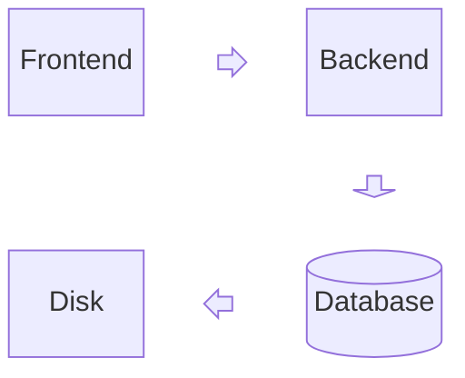

## Syntax

- `columns n` sets the grid; blocks fill it left to right.
- `id["label"]` is a block; the same brackets as a flowchart pick its shape, and `id:n` spans `n` columns.
- `space` or `space:n` leaves cells empty.
- `block:id … end` nests a grid; `id<["label"]>(right)` is an arrow block.
- `a --> b` joins two blocks; `classDef`, `class` and `style` restyle them.
