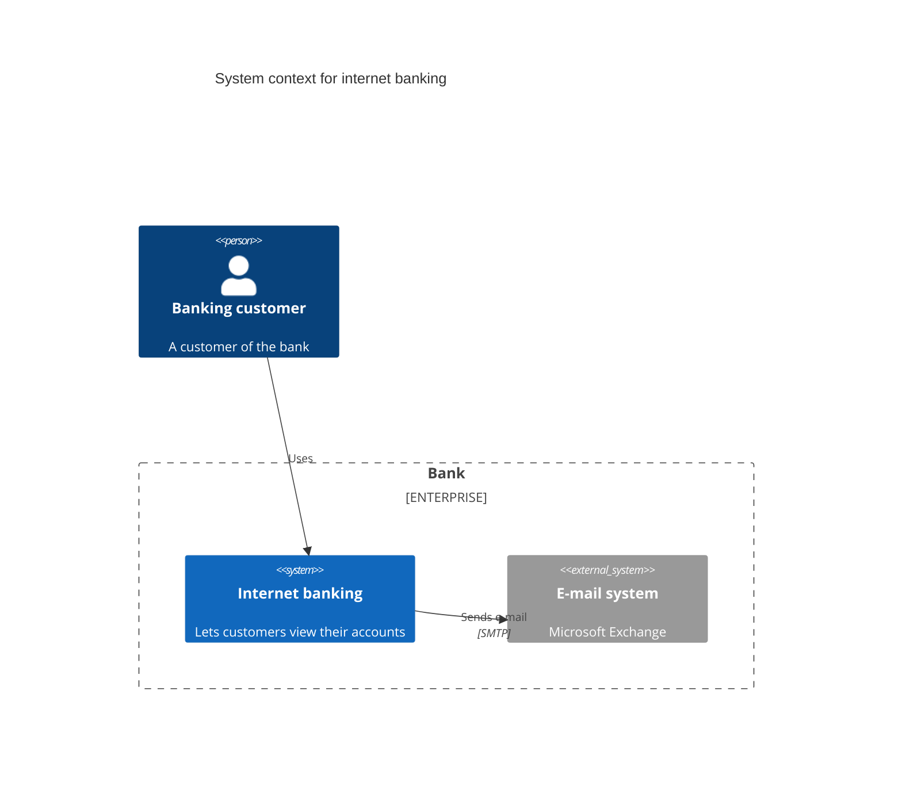

## Syntax

- `C4Context`, `C4Container`, `C4Component`, `C4Dynamic` and `C4Deployment` are the five levels.
- `Person`, `System`, `Container`, `Component` and their `_Ext`, `Db` and `Queue` forms declare elements as `(alias, label, description)`.
- `Enterprise_Boundary`, `System_Boundary` and `Boundary` group elements in `{ … }`.
- `Rel(from, to, label, technology)` relates two; `BiRel`, `Rel_U`, `Rel_D`, `Rel_L` and `Rel_R` are its variants.
