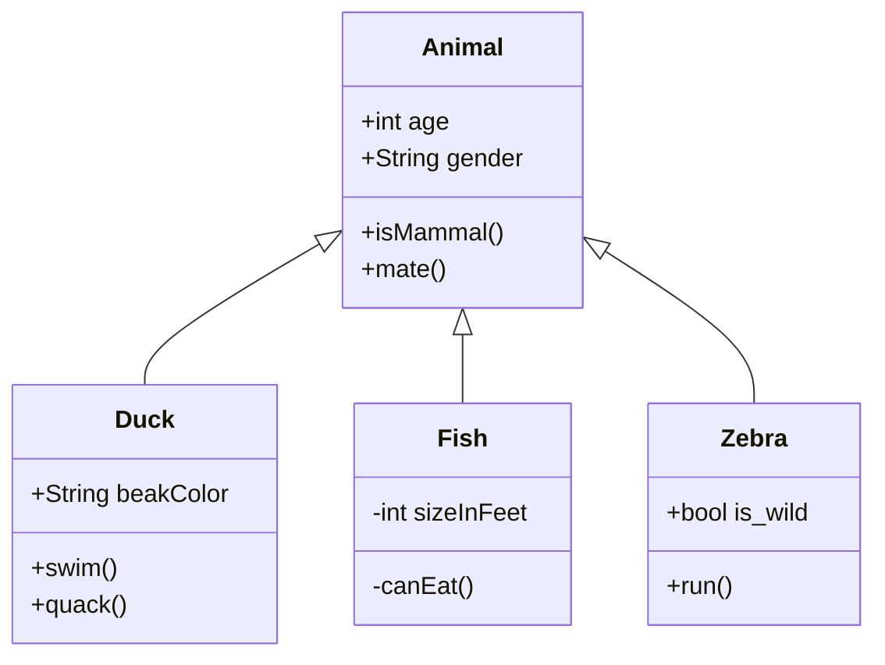

## Syntax

- `class Name { … }` lists members; `+`, `-`, `#` and `~` set visibility, and `()` makes a method.
- `Name : +member` adds one member outside the block.
- `<|--` is inheritance, `*--` composition, `o--` aggregation, `-->` association, `..>` dependency, `..|>` realization.
- `: text` after a relation labels it; quoted cardinalities sit at either end.
- `namespace Name { … }` groups classes; `note` and `note for Name` add notes.
