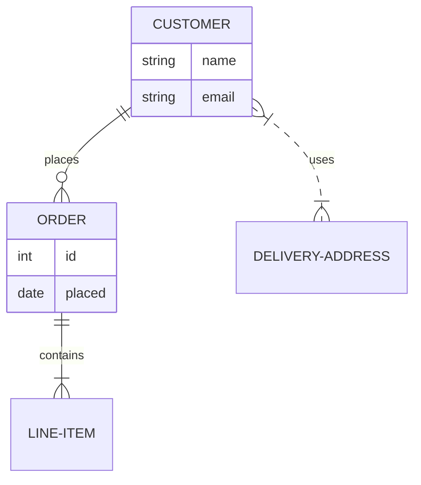

## Syntax

- `A ||--o{ B : label` relates two entities; each end's pair of marks is its cardinality — `|o` zero or one, `||` exactly one, `}o` zero or more, `}|` one or more.
- `--` is an identifying relationship, `..` a non-identifying one.
- `ENTITY { type name }` lists attributes; `PK`, `FK` and `UK` after one mark keys, and a quoted string comments it.
