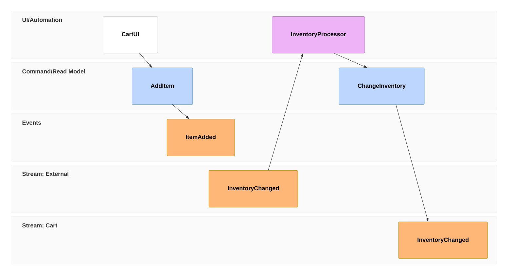

## Syntax

- `timeframe n kind Name` (or `tf`) puts an element on the timeline: `ui`, `command` (`cmd`), `event` (`evt`) or `processor`.
- `[[Data]]` after an element points at a `data Name { … }` block.
