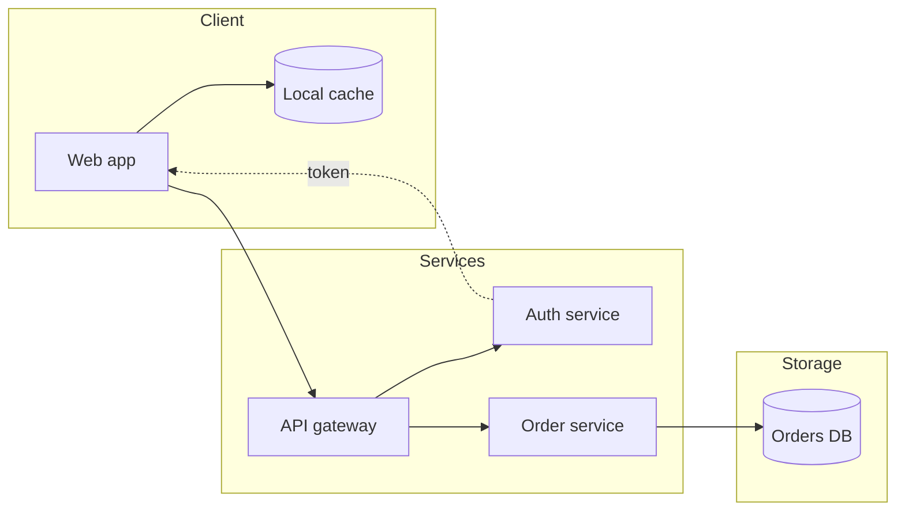

## Syntax

- `flowchart` (or `graph`) and a direction: `TB`, `TD`, `BT`, `LR` or `RL`.
- `A[text]` is a node; the brackets pick the shape — `(round)`, `([stadium])`, `[(database)]`, `((circle))`, `{decision}`, `{{hexagon}}`.
- `-->` is an arrow, `---` a line, `-.->` dotted, `==>` thick; `-- text -->` or `-->|text|` labels it.
- `subgraph name … end` groups nodes, and `direction` inside one sets its own.
- `classDef`, `class` and `style` restyle nodes.
