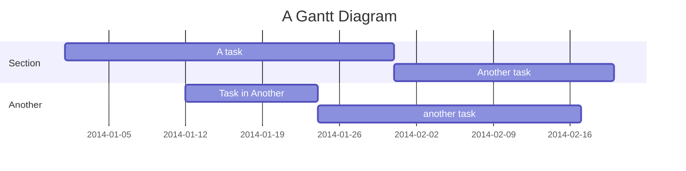

## Syntax

- `dateFormat` is how dates in the source are read; `axisFormat` how the axis prints them.
- `section` starts a group; `Task : id, start, length` is a task.
- A start is a date or `after id`; a length a duration such as `30d`, or an end date.
- `done`, `active`, `crit` and `milestone` before the id mark a task.
