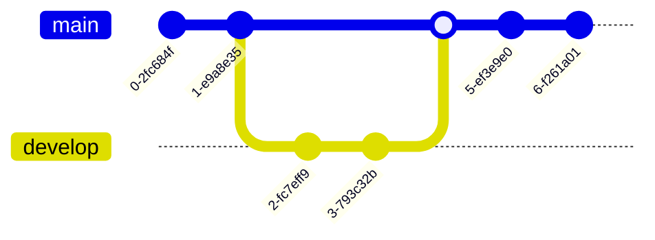

## Syntax

- `commit` adds a commit to the current branch; `id:`, `tag:` and `type:` (`NORMAL`, `REVERSE`, `HIGHLIGHT`) describe it.
- `branch name` starts a branch and `checkout name` (or `switch`) moves to one.
- `merge name` merges a branch into the current one; `cherry-pick id:` copies a commit.
