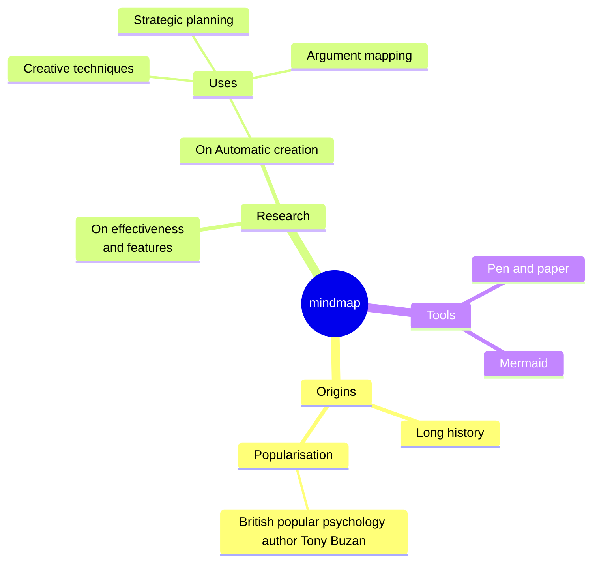

## Syntax

- Indentation is the tree; the first node is the root.
- `id((text))`, `id(text)`, `id[text]`, `id))text((` and `id{{text}}` pick a node's shape.
- `::icon(…)` and `:::class` on the next line decorate the node above.
