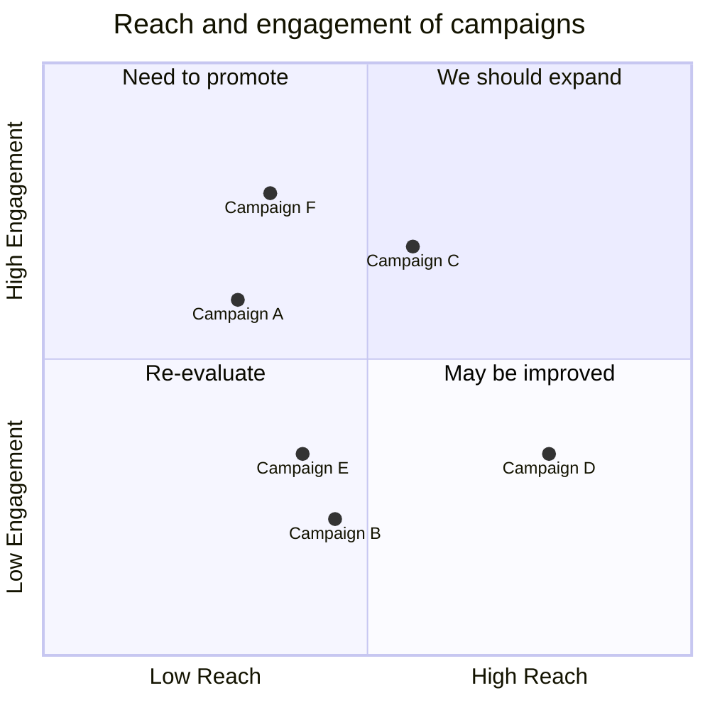

## Syntax

- `x-axis Low --> High` and `y-axis Low --> High` label the axes.
- `quadrant-1` to `quadrant-4` name the quadrants, from the top right anticlockwise.
- `Name: [x, y]` places a point, both between 0 and 1.
