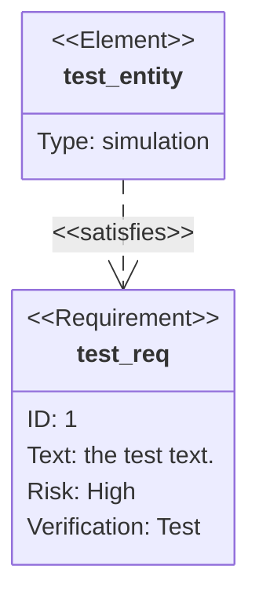

## Syntax

- `requirement name { … }` takes `id`, `text`, `risk` (`low`, `medium`, `high`) and `verifymethod` (`analysis`, `inspection`, `test`, `demonstration`).
- `functionalRequirement`, `performanceRequirement`, `interfaceRequirement`, `physicalRequirement` and `designConstraint` are the other kinds.
- `element name { type: …, docref: … }` is what meets one.
- `a - satisfies -> b` relates them; the others are `contains`, `copies`, `derives`, `verifies`, `refines` and `traces`.
