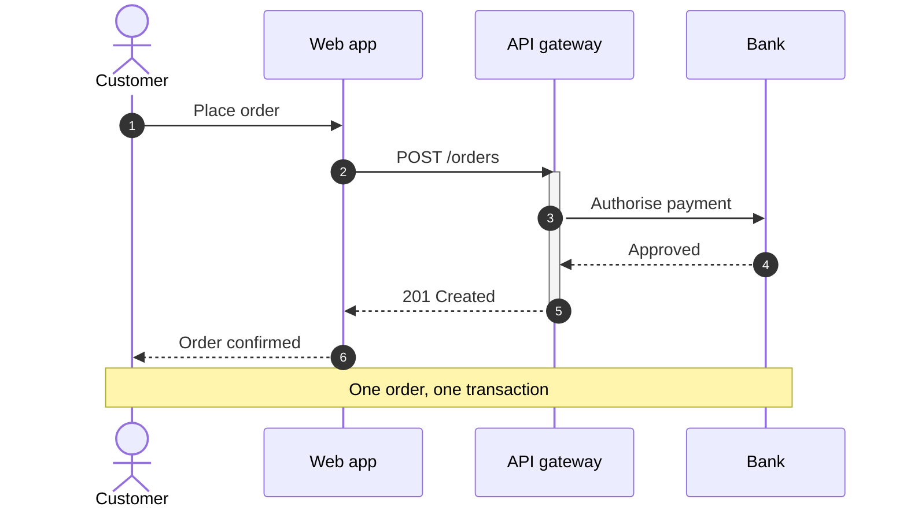

## Syntax

- `participant` and `actor` declare who takes part, in order; `as` gives one a label.
- `->>` is a solid arrow, `-->>` dashed, `-)` async, `-x` a cross.
- `activate` / `deactivate`, or `+` / `-` on an arrow, mark a lifeline busy.
- `Note left of`, `right of` or `over A,B` adds a note; `autonumber` numbers the messages.
- `loop`, `alt` / `else`, `opt`, `par`, `critical`, `break` and `rect` box a run of messages.
