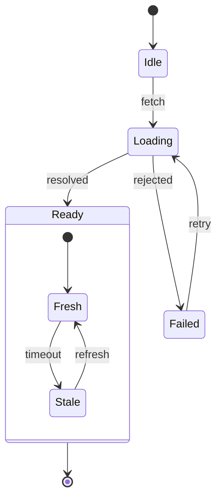

## Syntax

- `A --> B : event` is a transition; `[*]` is the start or the end.
- `state Name { … }` nests states; `--` inside one splits it into concurrent regions.
- `state x <<choice>>`, `<<fork>>` and `<<join>>` add pseudo-states.
- `note left of` or `right of` a state adds a note; `direction` sets the layout.
