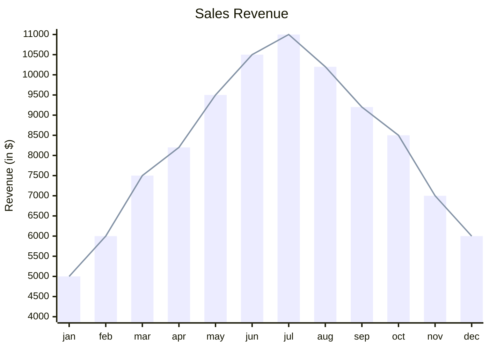

## Syntax

- `title`, then `x-axis` as a list of categories or `min --> max`, and `y-axis` as a label and a range.
- `bar [ … ]` and `line [ … ]` add series, one value per x.
- `xychart horizontal` turns the chart on its side.
